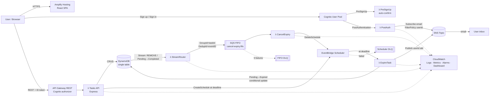
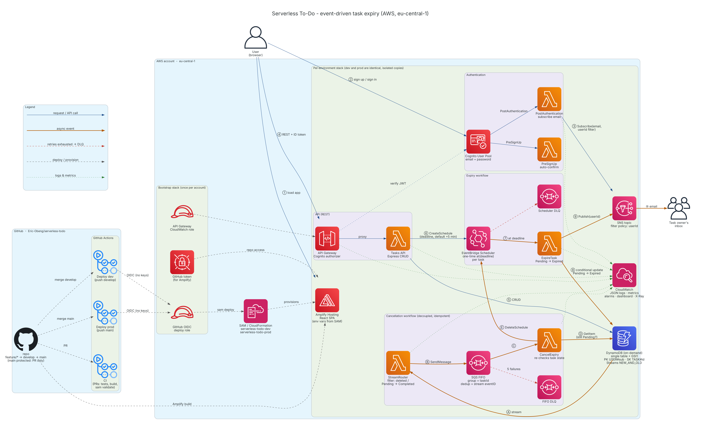

# Serverless To-Do with Event-Driven Expiry

A serverless task manager on AWS. Signed-in users manage their own tasks. Any task still **Pending** at its deadline is marked **Expired** automatically, and the owner gets an email about it. If a task is completed or deleted before its deadline, its scheduled expiry is cancelled through DynamoDB Streams → SQS FIFO → Lambda.

| Layer | Tech |
|---|---|
| Frontend | React 18 + Vite, `aws-amplify` v6 + `@aws-amplify/ui-react` Authenticator, hosted on **Amplify Hosting** |
| API | **API Gateway (REST)** + Cognito authorizer → **Lambda** running **Express** (`@codegenie/serverless-express`) |
| Auth | **Cognito User Pool** (email + password), PreSignUp auto-confirm, PostAuthentication → SNS subscribe |
| Data | **DynamoDB** on-demand, single-table design + GSI, Streams (NEW_AND_OLD_IMAGES) |
| Expiry | **EventBridge Scheduler** one-time `at()` schedule per task → ExpireTask Lambda → **SNS** email |
| Cancellation | DynamoDB Streams → StreamRouter Lambda → **SQS FIFO** → CancelExpiry Lambda (`DeleteSchedule`) |
| Observability | **CloudWatch** JSON logs (Powertools), custom metrics, alarms, dashboard, X-Ray, API access logs |
| IaC / CI/CD | **AWS SAM** (`template.yaml`, Amplify app included) + GitHub Actions (OIDC) |

## Repository layout

```
.
├── template.yaml                 # AWS SAM template: ALL infra incl. Amplify app
├── samconfig.toml                # sam build/deploy defaults (dev / prod)
├── amplify.yml                   # Amplify Hosting build spec (monorepo → frontend/)
├── .github/workflows/pipeline.yml# test → sam validate → sam build → sam deploy → Amplify build
├── infra/github-oidc-role.yaml   # one-time: IAM role for GitHub Actions OIDC
├── backend/
│   ├── src/api/                  # Express app (CRUD) + Lambda adapter + local dev server
│   │   ├── app.js  handler.js  local.js  taskRepository.js
│   │   ├── routes/tasks.js
│   │   └── middleware/{auth,errors}.js
│   ├── src/functions/            # Event-driven Lambdas
│   │   ├── preSignUp.js          # Cognito: auto-confirm
│   │   ├── postAuthentication.js # Cognito: subscribe email to SNS (userId filter policy)
│   │   ├── expireTask.js         # Scheduler target: Pending → Expired + SNS publish
│   │   ├── streamRouter.js       # DDB Stream → SQS FIFO
│   │   └── cancelExpiry.js       # SQS FIFO → DeleteSchedule (idempotent)
│   ├── src/lib/                  # AWS clients, config, keys, scheduler helpers, logger/metrics
│   ├── events/                   # sample events for `sam local invoke`
│   └── tests/                    # node:test unit tests
├── frontend/
│   └── src/{amplifyConfig.js, App.jsx, api/tasks.js, components/*}
└── docs/architecture/diagram.py  # diagram-as-code (mingrammer/diagrams)
```

## Architecture





To regenerate the AWS-icon diagram above (diagram-as-code), run:

```bash
pip install diagrams && sudo apt install graphviz   # or: brew install graphviz
python docs/architecture/diagram.py                  # → docs/architecture/architecture.png
```

### Data model (single table)

| Attribute | Example | Notes |
|---|---|---|
| `PK` | `USER#<cognito-sub>` | partition: one user's items |
| `SK` | `TASK#<uuid>` | |
| `GSI1PK` | `USER#<cognito-sub>` | |
| `GSI1SK` | `STATUS#Pending#2026-10-16T10:05:00.000Z` | list a user's tasks by status, sorted by deadline |
| `entityType` | `TASK` | leaves room for more entity types later |
| `taskId`, `userId` | | UUID / Cognito `sub` |
| `title`, `description`, `date` | | `date` = planned day (YYYY-MM-DD) |
| `status` | `Pending` \| `Completed` \| `Expired` | |
| `deadline` | ISO-8601 | defaults to **createdAt + 5 min** |
| `scheduleName` | `task-<uuid>` | EventBridge Scheduler schedule |
| `createdAt`, `updatedAt`, `completedAt`, `expiredAt`, `ownerEmail` | | |

Access patterns: list my tasks (`PK`), list my tasks by status (`GSI1` + `begins_with`), get/update/delete a task (`PK`+`SK`).

### API

All routes need `Authorization: <Cognito ID token>`.

| Method | Path | Body |
|---|---|---|
| GET | `/tasks?status=Pending\|Completed\|Expired` | |
| GET | `/tasks/{taskId}` | |
| POST | `/tasks` | `{ title, description?, date?, deadline? }` |
| PUT | `/tasks/{taskId}` | any of `{ title, description, date, deadline, status: Pending\|Completed }` |
| DELETE | `/tasks/{taskId}` | |

### How the event-driven parts work

**Expiry**
1. `POST /tasks` writes the item, then creates a one-time EventBridge Scheduler schedule `task-<id>` set to `at(deadline)`, with `ActionAfterCompletion: DELETE` and a DLQ.
2. At the deadline, Scheduler invokes **ExpireTask** with `{ taskId, userId }`.
3. ExpireTask runs a **conditional** update (`status = Pending AND deadline = <read value>`) to set `Expired`. Retries, duplicates and a race with "complete" are all no-ops.
4. It then publishes to SNS with the message attribute `userId`. Each user's email subscription has the filter policy `{"userId":["<sub>"]}`, so only the owner gets the email.

**Cancellation (decoupled + idempotent)**
1. Completing (`Pending → Completed`) or deleting a Pending task emits a DynamoDB Stream record.
2. The event source mapping **filters** the stream down to exactly those two shapes. **StreamRouter** checks the record again and sends it to **SQS FIFO** with `MessageGroupId = taskId` (ordered per task) and `MessageDeduplicationId = stream eventID`, so stream retries can't create duplicates.
3. **CancelExpiry** deletes the schedule. A `ResourceNotFound` counts as success (the schedule already fired, was already cancelled, or this is a duplicate), which makes the step idempotent. Failures use partial batch responses, and after 5 tries a message moves to the FIFO DLQ, which has an alarm.

## Getting started

### Prerequisites
- AWS account and AWS CLI v2 with credentials configured
- AWS SAM CLI ≥ 1.120
- Node.js 22

### 1. Deploy the backend

```bash
cd backend && npm ci && cd ..
export PATH="$PWD/backend/node_modules/.bin:$PATH"   # sam build needs esbuild (or: npm i -g esbuild)
sam build
sam deploy --guided        # first time; later runs just use: sam deploy
```

`FrontendRepositoryUrl` can stay empty on the first deploy if you only want the backend. The stack outputs include `ApiUrl`, `UserPoolId`, `UserPoolClientId` and `Region`.

### 2. Run the frontend locally

```bash
cd frontend
cp .env.example .env.local   # fill from the stack outputs
npm ci && npm run dev        # http://localhost:5173
```

### 3. Host the frontend on Amplify (all in SAM)

1. Create a GitHub fine-grained PAT with read access to **Contents** and **Webhooks** on the repo. Store it as a plain-text secret:
   ```bash
   aws secretsmanager create-secret --name serverless-todo/github-token --secret-string '<PAT>'
   ```
2. Deploy with the repo URL:
   ```bash
   sam deploy --parameter-overrides Stage=dev FrontendRepositoryUrl=https://github.com/<you>/<repo>
   ```
3. Start the first build, since a branch created by CloudFormation doesn't build on its own. The pipeline does this step for you.
   ```bash
   aws amplify start-job --app-id <AmplifyAppId> --branch-name main --job-type RELEASE
   ```

The template sets `VITE_USER_POOL_ID`, `VITE_USER_POOL_CLIENT_ID`, `VITE_API_URL` and `VITE_AWS_REGION` as Amplify environment variables. `frontend/src/amplifyConfig.js` reads them to register Cognito and the REST API with `Amplify.configure`.

> If the frontend has its own repo, set `FrontendAppRoot=.` and move `amplify.yml` into that repo. Change `appRoot` in that file to match.

### 4. CI/CD pipeline (GitHub Actions)

```bash
aws cloudformation deploy --template-file infra/github-oidc-role.yaml \
  --stack-name serverless-todo-github-oidc --capabilities CAPABILITY_NAMED_IAM \
  --parameter-overrides GitHubOrg=<owner> GitHubRepo=<repo>
```

In the GitHub repo settings:
- Secret `AWS_DEPLOY_ROLE_ARN`: the `DeployRoleArn` output from the stack above
- Optional variables: `AWS_REGION`, `STACK_NAME`, `ALARM_EMAIL`

Every push to `main` then runs unit tests → frontend build → `sam validate --lint` → `sam build` → `sam deploy` → Amplify release job.

### Branching

`main` is protected: it only changes through pull requests, and only `main` deploys.

```
feature/<name> ──PR──▶ develop ──PR──▶ main ──▶ sam deploy + Amplify release
```

```bash
git checkout develop && git pull
git checkout -b feature/my-change
# ...commit...
git push -u origin feature/my-change      # open PR into develop
```

When `develop` is ready to release, open a PR `develop → main`. The `test` job must pass before it can merge.

### Local API (optional)

```bash
cd backend && cp .env.example .env   # point at deployed table/scheduler
npm run dev                          # http://localhost:3001 (JWT decoded, NOT verified - dev only)
```

## Demo checklist (live review)

1. **Sign up** with email and password in the Amplify app. You're signed in straight away, with no confirmation code (PreSignUp).
2. Open the **"AWS Notification - Subscription Confirmation"** email and click *Confirm subscription*. PostAuthentication subscribed you. SNS email subscriptions have to be confirmed by the recipient.
3. **Create** a task with no deadline (defaults to 5 min). Show the item in DynamoDB and the `task-<id>` schedule in EventBridge Scheduler → Schedules → group `<stack>-task-expiry`.
4. **Update** the title or description, **complete** a second task and **delete** a third. Show their schedules disappearing, plus the StreamRouter and CancelExpiry logs in CloudWatch.
5. Wait for the first task's deadline. Its status flips to **Expired** in the UI (the list auto-refreshes every 15 s) and the **expiry email** arrives.
6. Show the CloudWatch dashboard `<stack>`, the alarms, the Lambda JSON logs and the X-Ray traces.
7. Push a commit and show the GitHub Actions run deploying through SAM.

### Quick API test with curl

```bash
TOKEN=$(aws cognito-idp initiate-auth --auth-flow USER_PASSWORD_AUTH \
  --client-id <UserPoolClientId> --auth-parameters USERNAME=<email>,PASSWORD=<pwd> \
  --query AuthenticationResult.IdToken --output text)
curl -H "Authorization: $TOKEN" -H 'Content-Type: application/json' \
  -d '{"title":"Demo task"}' <ApiUrl>/tasks
```

## Security / least privilege

- Each Lambda has its own role, limited to the exact actions and resources it needs. The API can only call `Get/Put/Update/Delete/Query` on the table and its GSI, and `Create/UpdateSchedule` inside the schedule group. CancelExpiry can only call `DeleteSchedule`.
- `iam:PassRole` on the scheduler role only works when `iam:PassedToService = scheduler.amazonaws.com`.
- The Scheduler role can only invoke ExpireTask and write to its DLQ (with an `aws:SourceAccount` condition).
- Users only ever see their own items: the partition key comes from the verified token `sub`, never from the request.
- SNS filter policies mean each user only receives their own notifications.
- Table, queues and topics use encryption at rest. DynamoDB has PITR on.
- `infra/github-oidc-role.yaml` uses `AdministratorAccess` to keep the lab simple. Scope it down for real use.
