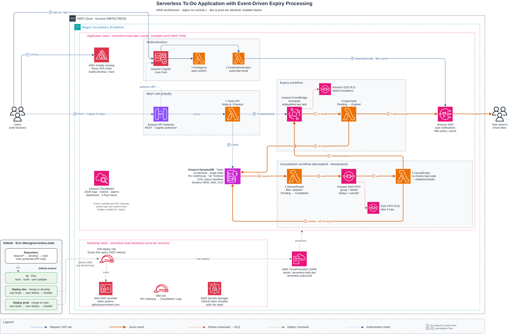

# Serverless To-Do with Event-Driven Expiry

A serverless task manager on AWS. Signed-in users manage their own tasks. Any task still **Pending** at its deadline is marked **Expired** automatically, and the owner gets an email about it. If a task is completed or deleted before its deadline, its scheduled expiry is cancelled through DynamoDB Streams → SQS FIFO → Lambda.

| Layer | Tech |
|---|---|
| Frontend | React 18 + Vite, `aws-amplify` v6 + `@aws-amplify/ui-react` Authenticator, hosted on **Amplify Hosting** |
| API | **API Gateway (REST)** + Cognito authorizer → **Lambda** running **Express** (`@codegenie/serverless-express`) |
| Auth | **Cognito User Pool** (email + password), PreSignUp auto-confirm, PostAuthentication → SNS subscribe |
| Data | **DynamoDB** on-demand, single-table design + GSI, Streams (NEW_AND_OLD_IMAGES) |
| Expiry | **EventBridge Scheduler** one-time `at()` schedule per task → ExpireTask Lambda → **SNS** email |
| Cancellation | DynamoDB Streams → StreamRouter Lambda → **SQS FIFO** → CancelExpiry Lambda (`DeleteSchedule`) |
| Observability | **CloudWatch** JSON logs (Powertools), custom metrics, alarms, dashboard, X-Ray, API access logs |
| IaC / CI/CD | **AWS SAM** (`template.yaml`, Amplify app included) + GitHub Actions (OIDC) |

## Repository layout

```
.
├── template.yaml                 # AWS SAM template: ALL infra incl. Amplify app
├── samconfig.toml                # sam build/deploy defaults (dev / prod)
├── amplify.yml                   # Amplify Hosting build spec (monorepo → frontend/)
├── .github/workflows/
│   ├── ci.yml                    # PRs: tests, frontend build, sam validate (never touches AWS)
│   ├── deploy-dev.yml            # push to develop → CI → deploy dev
│   ├── deploy-prod.yml           # push to main    → CI → deploy prod
│   └── deploy.yml                # shared deploy steps (sam build/deploy → Amplify build)
├── infra/bootstrap.yaml         # one-time per account: API GW logging role + GitHub OIDC deploy role
├── backend/
│   ├── src/api/                  # Express app (CRUD) + Lambda adapter + local dev server
│   │   ├── app.js  handler.js  local.js  taskRepository.js
│   │   ├── routes/tasks.js
│   │   └── middleware/{auth,errors}.js
│   ├── src/functions/            # Event-driven Lambdas
│   │   ├── preSignUp.js          # Cognito: auto-confirm
│   │   ├── postAuthentication.js # Cognito: subscribe email to SNS (userId filter policy)
│   │   ├── expireTask.js         # Scheduler target: Pending → Expired + SNS publish
│   │   ├── streamRouter.js       # DDB Stream → SQS FIFO
│   │   └── cancelExpiry.js       # SQS FIFO → DeleteSchedule (idempotent)
│   ├── src/lib/                  # AWS clients, config, keys, scheduler helpers, logger/metrics
│   ├── events/                   # sample events for `sam local invoke`
│   └── tests/                    # node:test unit tests
├── frontend/
│   └── src/{amplifyConfig.js, App.jsx, api/tasks.js, components/*}
└── docs/architecture/diagram.py  # diagram-as-code (mingrammer/diagrams)
```

## Architecture



The main diagram is a draw.io file using the official AWS icon set: [`docs/architecture/architecture.drawio`](docs/architecture/architecture.drawio). Open it in [diagrams.net](https://app.diagrams.net) or the draw.io desktop app / VS Code extension to edit it, then export it to `architecture-drawio.png`. A diagram-as-code version of the same architecture is in [`diagram.py`](docs/architecture/diagram.py), which renders [`architecture.png`](docs/architecture/architecture.png).

Both diagrams use the same numbers and letters on their arrows, which match the walkthrough below. Dev and prod are two identical, isolated copies of the "Application stack" in the account's `eu-central-1` region.

**Request path (blue)**

| # | Step |
|---|---|
| ① | The browser loads the React SPA from **Amplify Hosting**. The SPA's Cognito and API settings come from `VITE_*` env vars that SAM sets on the Amplify app. |
| ② | The user signs up or signs in against the **Cognito User Pool** (email + password). The **PreSignUp** Lambda auto-confirms new users. |
| ③ | After sign-in, the **PostAuthentication** Lambda subscribes the user's email to the **SNS** topic with the filter policy `{"userId": ["<sub>"]}`. |
| ④ | The SPA calls **API Gateway (REST)** with the Cognito ID token. The Cognito authorizer verifies the JWT before any Lambda runs. |
| ⑤ | The **Tasks API** Lambda (Express) does the CRUD in **DynamoDB**. The user ID always comes from the verified token. |
| ⑥ | On create, and on a deadline change or reopen, the API creates or updates a one-time **EventBridge Scheduler** schedule `task-<id>` at the deadline (default: now + 5 min). |

**Expiry (orange)**

| # | Step |
|---|---|
| ⑦ | At the deadline, Scheduler invokes **ExpireTask** with `{taskId, userId}`. Retries are built in, and failures go to the Scheduler DLQ. |
| ⑧ | A conditional update changes `Pending → Expired`. It's a no-op if the task was completed, deleted or already expired, so duplicates and races are safe. |
| ⑨ | ExpireTask publishes to SNS with the message attribute `userId`. |
| ⑩ | The subscription filter policy delivers the email to the task owner only. |

**Cancellation (orange; decoupled and idempotent)**

| # | Step |
|---|---|
| Ⓐ | Completing a Pending task, or deleting it, writes a **DynamoDB Stream** record. The event source mapping filters the stream to exactly those two changes. |
| Ⓑ | **StreamRouter** sends a message to **SQS FIFO**: `MessageGroupId = taskId` (ordered per task), `MessageDeduplicationId = stream eventID` (stream retries can't create duplicates). |
| Ⓒ | **CancelExpiry** consumes the queue with partial batch failures. After 5 failed attempts a message goes to the FIFO DLQ. |
| Ⓓ | It re-reads the task (consistent read). If the task is **Pending again** (reopened or rescheduled before the cancellation ran), it keeps the schedule. |
| Ⓔ | Otherwise it deletes the schedule. "Not found" counts as success, which makes cancellation idempotent. |

**Delivery (grey dashed):** PRs run **CI**. A merge to `develop` or `main` runs **Deploy dev** or **Deploy prod**, which log in to AWS through **GitHub OIDC** (no stored keys) and run `sam deploy`. CloudFormation then provisions the stack and the Amplify build. The **bootstrap stack** holds the account-level pieces: the OIDC deploy role, API Gateway's CloudWatch role and the GitHub token for Amplify.

**Observability (green dotted):** all Lambdas and API Gateway send JSON logs, custom metrics and X-Ray traces to **CloudWatch**, which also has a dashboard and alarms (Lambda errors, API 5XX, both DLQs).

To regenerate the diagram:

```bash
pip install diagrams && sudo apt install graphviz   # or: brew install graphviz
python docs/architecture/diagram.py                  # → docs/architecture/architecture.png
```

### Data model (single table)

| Attribute | Example | Notes |
|---|---|---|
| `PK` | `USER#<cognito-sub>` | partition: one user's items |
| `SK` | `TASK#<uuid>` | |
| `GSI1PK` | `USER#<cognito-sub>` | |
| `GSI1SK` | `STATUS#Pending#2026-10-16T10:05:00.000Z` | list a user's tasks by status, sorted by deadline |
| `entityType` | `TASK` | leaves room for more entity types later |
| `taskId`, `userId` | | UUID / Cognito `sub` |
| `title`, `description`, `date` | | `date` = planned day (YYYY-MM-DD) |
| `status` | `Pending` \| `Completed` \| `Expired` | |
| `deadline` | ISO-8601 | defaults to **createdAt + 5 min** |
| `scheduleName` | `task-<uuid>` | EventBridge Scheduler schedule |
| `createdAt`, `updatedAt`, `completedAt`, `expiredAt`, `ownerEmail` | | |

Access patterns: list my tasks (`PK`), list my tasks by status (`GSI1` + `begins_with`), get/update/delete a task (`PK`+`SK`).

### API

All routes need `Authorization: <Cognito ID token>`.

| Method | Path | Body |
|---|---|---|
| GET | `/tasks?status=Pending\|Completed\|Expired` | |
| GET | `/tasks/{taskId}` | |
| POST | `/tasks` | `{ title, description?, date?, deadline? }` |
| PUT | `/tasks/{taskId}` | any of `{ title, description, date, deadline, status: Pending\|Completed }` |
| DELETE | `/tasks/{taskId}` | |

## Getting started

### Environments

Two fully separate stacks, each with its own user pool, table, topic, API and Amplify app:

| Environment | Git branch | Stack | `Stage` | Deploys when |
|---|---|---|---|---|
| **dev** | `develop` | `serverless-todo-dev` | `dev` | a PR is merged into `develop` |
| **prod** | `main` | `serverless-todo-prod` | `prod` | a PR is merged into `main` |

Users, tasks and SNS subscriptions don't carry over between environments. Sign up and confirm the subscription email in each one.

### Prerequisites
- AWS account and AWS CLI v2 with credentials configured
- AWS SAM CLI ≥ 1.120
- Node.js 22

### 0. Bootstrap the account (once)

`infra/bootstrap.yaml` holds what dev and prod share: API Gateway's CloudWatch Logs role (one per account and region) and the IAM role GitHub Actions uses to deploy. Deploy it **before** any app stack, because API logging fails without that role.

```bash
aws cloudformation deploy --template-file infra/bootstrap.yaml \
  --stack-name serverless-todo-bootstrap --capabilities CAPABILITY_NAMED_IAM \
  --parameter-overrides GitHubOrg=<owner> GitHubRepo=<repo> GitHubOwnerId=<id> GitHubRepoId=<id>
```

GitHub's login token identifies the repo as `repo:<owner>@<ownerId>/<repo>@<repoId>:...`. Pinning the numeric IDs means a renamed or re-created account can't take over the deploy role. To get them, run `curl -s https://api.github.com/repos/<owner>/<repo>`: the top-level `id` is the repo's, and `owner.id` is the owner's. Add `CreateOidcProvider=false` if the account already has the GitHub provider.

> **Upgrading a dev stack created before this file existed:** that stack created its own API Gateway logging role. Deploy the bootstrap stack **first**, then update dev. Dev then removes its old copy, and the account setting already points at the bootstrap role.

### 1. Deploy the backend manually (optional, the pipeline does this)

```bash
cd backend && npm ci && cd ..
export PATH="$PWD/backend/node_modules/.bin:$PATH"   # sam build needs esbuild (or: npm i -g esbuild)
sam build

# dev
sam deploy --parameter-overrides Stage=dev FrontendBranch=develop \
  FrontendRepositoryUrl=https://github.com/<you>/<repo>

# prod
sam deploy --config-env prod --parameter-overrides Stage=prod FrontendBranch=main \
  FrontendRepositoryUrl=https://github.com/<you>/<repo>
```

`--parameter-overrides` on the command line replaces the values saved in `samconfig.toml`, so add `AlarmEmail=<you@example.com>` if you want it. Leave `FrontendRepositoryUrl` out to deploy only the backend. Each stack's outputs include `ApiUrl`, `UserPoolId`, `UserPoolClientId` and `Region`.

### 2. Run the frontend locally

```bash
cd frontend
cp .env.example .env.local   # fill from the dev stack outputs
npm ci && npm run dev        # http://localhost:5173
```

### 3. Host the frontend on Amplify (all in SAM)

Amplify needs a GitHub token to read the repo and register a webhook on it. Create a **classic** token at https://github.com/settings/tokens/new with the scopes **`repo`** and **`admin:repo_hook`**, and set the expiration past your review date. Store it once in the deploy region, which both environments use:

```bash
aws secretsmanager create-secret --name serverless-todo/github-token \
  --secret-string 'ghp_xxxxxxxxxxxxxxxxxxxx' --region eu-central-1
# replacing an existing token:
aws secretsmanager put-secret-value --secret-id serverless-todo/github-token \
  --secret-string 'ghp_xxxxxxxxxxxxxxxxxxxx' --region eu-central-1
```

- The secret must be **plain text**, the token alone. Key/value JSON (`{"token": ...}`) makes Amplify fail.
- Check the stored token before deploying. This should print your GitHub login, not `"Bad credentials"`:
  ```bash
  curl -s -H "Authorization: Bearer $(aws secretsmanager get-secret-value --secret-id serverless-todo/github-token \
    --query SecretString --output text --region eu-central-1)" https://api.github.com/user | grep -E '"login"|"message"'
  ```

When `FrontendRepositoryUrl` is set, each stack creates its own Amplify app connected to its own branch (`develop` or `main`). Amplify's auto-build is **off**. The pipeline starts a build after `sam deploy`, so the frontend always builds against the backend it was deployed with. After a manual deploy, start the build yourself:

```bash
aws amplify start-job --app-id <AmplifyAppId> --branch-name <develop|main> --job-type RELEASE
```

The template sets `VITE_USER_POOL_ID`, `VITE_USER_POOL_CLIENT_ID`, `VITE_API_URL` and `VITE_AWS_REGION` as Amplify environment variables. `frontend/src/amplifyConfig.js` reads them to register Cognito and the REST API with `Amplify.configure`. The app URL is the `AmplifyAppUrl` stack output.

> If the frontend has its own repo, set `FrontendAppRoot=.` and move `amplify.yml` into that repo. Change `appRoot` in that file to match.

### 4. CI/CD pipeline (GitHub Actions)

After step 0, set up the GitHub repo:
- **Secret** `AWS_DEPLOY_ROLE_ARN`: the `DeployRoleArn` output of `serverless-todo-bootstrap`
- **Environments** (Settings → Environments): create `dev` and `prod`. For `prod`, you can add *Required reviewers* or limit *Deployment branches* to `main`.
- **Optional variables:** `AWS_REGION` (default `eu-central-1`), `ALARM_EMAIL`

Separate workflows for checking, dev and prod:

| Workflow | Trigger | Steps |
|---|---|---|
| **CI** (`ci.yml`) | PR into `develop` or `main` | unit tests → frontend build → `sam validate --lint` |
| **Deploy dev** (`deploy-dev.yml`) | push/merge to `develop`, or manual | CI → deploy `serverless-todo-dev` |
| **Deploy prod** (`deploy-prod.yml`) | push/merge to `main`, or manual | CI → deploy `serverless-todo-prod` |

Both deploy workflows call the same reusable `deploy.yml` (`sam build` → `sam deploy` → Amplify release job), so dev and prod are always deployed the same way. Each one only deploys from its own branch, including manual runs. To re-deploy without a new commit, open **Actions → Deploy dev / Deploy prod → Run workflow**.

### Branching

`main` is protected and only changes through pull requests. Changes reach prod by going through dev first.

```
feature/<name> ──PR──▶ develop ──▶ deploy dev ──PR──▶ main ──▶ deploy prod
```

```bash
git checkout develop && git pull
git checkout -b feature/my-change
# ...commit...
git push -u origin feature/my-change      # open PR into develop
```

When dev looks good, open a PR `develop → main`. The `test` job must pass before it can merge.

### Local API (optional)

```bash
cd backend && cp .env.example .env   # point at deployed table/scheduler
npm run dev                          # http://localhost:3001 (JWT decoded, NOT verified - dev only)
```

## Demo checklist (live review)

1. **Sign up** with email and password in the Amplify app. You're signed in straight away, with no confirmation code (PreSignUp).
2. Open the **"AWS Notification - Subscription Confirmation"** email and click *Confirm subscription*. PostAuthentication subscribed you. SNS email subscriptions have to be confirmed by the recipient.
3. **Create** a task with no deadline (defaults to 5 min). Show the item in DynamoDB and the `task-<id>` schedule in EventBridge Scheduler → Schedules → group `<stack>-task-expiry`.
4. **Update** the title or description, **complete** a second task and **delete** a third. Show their schedules disappearing, plus the StreamRouter and CancelExpiry logs in CloudWatch.
5. Wait for the first task's deadline. Its status flips to **Expired** in the UI (the list auto-refreshes every 15 s) and the **expiry email** arrives.
6. Show the CloudWatch dashboard `<stack>`, the alarms, the Lambda JSON logs and the X-Ray traces.
7. Merge a PR into `develop` and show the GitHub Actions run deploying dev through SAM. Then promote it with a PR `develop → main` to deploy prod.

### Quick API test with curl

```bash
TOKEN=$(aws cognito-idp initiate-auth --auth-flow USER_PASSWORD_AUTH \
  --client-id <UserPoolClientId> --auth-parameters USERNAME=<email>,PASSWORD=<pwd> \
  --query AuthenticationResult.IdToken --output text)
curl -H "Authorization: $TOKEN" -H 'Content-Type: application/json' \
  -d '{"title":"Demo task"}' <ApiUrl>/tasks
```

## Security / least privilege

- Each Lambda has its own role, limited to the exact actions and resources it needs. The API can only call `Get/Put/Update/Delete/Query` on the table and its GSI, and `Create/UpdateSchedule` inside the schedule group. CancelExpiry can only call `DeleteSchedule`.
- `iam:PassRole` on the scheduler role only works when `iam:PassedToService = scheduler.amazonaws.com`.
- The Scheduler role can only invoke ExpireTask and write to its DLQ (with an `aws:SourceAccount` condition).
- Users only ever see their own items: the partition key comes from the verified token `sub`, never from the request.
- SNS filter policies mean each user only receives their own notifications.
- Table, queues and topics use encryption at rest. DynamoDB has PITR on.
- The GitHub deploy role in `infra/bootstrap.yaml` uses `AdministratorAccess` to keep the lab simple. Scope it down for real use.
